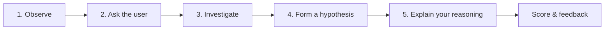

# IT Helpdesk Simulator

**A training game where you solve realistic IT support tickets the way a real helpdesk technician would.**


IT Helpdesk Simulator is a small web app that runs in your browser. You get a support ticket from a (fictional) colleague, for example *"My laptop is connected to Wi-Fi but I can't open any websites"*. Your job is to find out what is really wrong. You do that by asking questions, running diagnostic tools, choosing the most likely cause, and explaining why. The game then scores your diagnosis **and** your reasoning.

It is built for junior IT staff, students, and anyone who wants to practise structured troubleshooting without the risk of breaking a real computer.

> [!NOTE]
> All tools in the game are **simulated**. Nothing is ever run on your own computer.

---

## Table of Contents

- [Features](#features)
- [How the game works](#how-the-game-works)
- [Getting started](#getting-started)
  - [Prerequisites](#prerequisites)
  - [Installation](#installation)
  - [Running the app](#running-the-app)
- [Usage](#usage)
- [Scoring](#scoring)
- [Included scenarios](#included-scenarios)
- [Adding your own tickets](#adding-your-own-tickets)
- [API reference](#api-reference)
- [Project structure](#project-structure)
- [Tech stack](#tech-stack)
- [Limitations](#limitations)
- [Roadmap](#roadmap)
- [Contributing](#contributing)
- [License](#license)

---

## Features

| Feature | Description |
|---|---|
| **20 realistic tickets** | Common problems a junior IT technician runs into. |
| **Wide range of topics** | Networking, Windows, hardware, accounts, permissions, Microsoft 365, applications, security, peripherals and data recovery. |
| **Ask the user** | Ask follow-up questions and see why each answer matters. |
| **Simulated tools** | Run tools such as `ipconfig`, `ping` and `nslookup` and read their (fake) output. |
| **Hypotheses** | Choose the cause that best matches your evidence. |
| **Written reasoning** | Explain your diagnosis in your own words. |
| **XP, level and reputation** | Earn points for good work and lose them for wrong diagnoses. |
| **Difficulty ratings** | Each ticket is rated from ★ (easy) to ★★★ (hard). |
| **Search** | Filter tickets by title, area or ticket number. |
| **No database** | All tickets live in a single JSON file. |

## How the game works

Every ticket follows the same five steps, the same way a real technician works:



| Step | What you do | Why it matters |
|---|---|---|
| **1. Observe** | Read the user's report and the symptoms. | Separate facts from assumptions. |
| **2. Ask the user** | Click questions to see the user's answers. | Gather information before changing anything. |
| **3. Investigate** | Run simulated tools and read the output. | Each test should rule something in or out. |
| **4. Form a hypothesis** | Pick the most likely cause from a list. | Commit to the explanation that fits the evidence best. |
| **5. Explain** | Write down how the evidence led you to your answer. | A good technician can explain *why*, not just *what*. |

## Getting started

### Prerequisites

- [Python](https://www.python.org/downloads/) **3.9 or newer**
- [Git](https://git-scm.com/downloads) (optional — you can also download the ZIP)
- A modern web browser

Check your Python version:

```bash
python --version
```

### Installation

**1. Get the code**

```bash
git clone https://github.com/Starley-iggy/IThelpdesk.git
cd IThelpdesk
```

Or click **Code → Download ZIP** on GitHub and unzip it.

**2. Create a virtual environment (recommended)**

A virtual environment keeps this project's packages separate from the rest of your computer.

<details>
<summary>Windows (PowerShell)</summary>

```powershell
py -m venv .venv
.\.venv\Scripts\Activate.ps1
```

</details>

<details>
<summary>macOS / Linux</summary>

```bash
python3 -m venv .venv
source .venv/bin/activate
```

</details>

**3. Install the dependencies**

```bash
python -m pip install -r requirements.txt
```

### Running the app

```bash
python server.py
```

Then open <http://127.0.0.1:5000> in your browser.

To stop the app, press `Ctrl + C` in the terminal.

## Usage

1. **Pick a ticket** from the list on the left. Use the search box to filter.
2. **Read the user report** and the list of symptoms.
3. **Click the questions** under *Ask the user* to see the answers. Each one also explains why it's useful.
4. **Run tools** under *Investigate*. The output appears below the tools, with a short note on what it tells you.
5. **Choose a hypothesis**, the cause you think is most likely.
6. **Write your reasoning** in the text box. Mention the specific test results that support your choice.
7. Click **Submit diagnosis** to see whether you were right, your score, and coaching on your reasoning.

Your XP, level and reputation are shown in the top-right corner.

## Scoring

Each submission is scored like this:

| Rule | Points |
|---|---|
| Correct diagnosis | **+100** |
| Wrong diagnosis | **−50** |
| Each relevant keyword in your reasoning (max. 3) | **+15** (up to +45) |
| Reasoning shorter than 25 characters | **−15** |

- **XP** goes up and down with your score, but never below 0.
- **Level** goes up by one for every 250 XP.
- **Reputation** only increases with correct diagnoses and decreases with wrong ones.

> [!TIP]
> You get the best score by naming the specific evidence, for example *"the gateway ping works but the DNS server times out"*, instead of just repeating the answer.

## Included scenarios

| ID | Ticket | Area | Difficulty | Priority |
|---|---|---|---|---|
| TKT-001 | No Internet Access | Networking | ★ | Medium |
| TKT-002 | Computer Extremely Slow | Windows | ★ | Low |
| TKT-003 | VPN Will Not Connect | Networking | ★★ | High |
| TKT-004 | Printer Not Printing | Peripherals | ★ | Medium |
| TKT-005 | Account Locked | Accounts | ★ | Medium |
| TKT-006 | Shared Drive Access Denied | Permissions | ★★ | Medium |
| TKT-007 | Outlook Not Syncing | Microsoft 365 | ★★ | High |
| TKT-008 | Teams Microphone Not Working | Applications | ★ | Low |
| TKT-009 | USB Device Not Recognized | Hardware | ★★ | Low |
| TKT-010 | Second Monitor Not Detected | Hardware | ★ | Low |
| TKT-011 | Password Expired | Accounts | ★ | Medium |
| TKT-012 | Application Crashes on Launch | Applications | ★★ | Medium |
| TKT-013 | Windows Service Stopped | Windows | ★★ | High |
| TKT-014 | Wi-Fi Keeps Disconnecting | Networking | ★★ | Medium |
| TKT-015 | Suspicious Login Alert | Security | ★★★ | Critical |
| TKT-016 | DNS Only One Website Fails | Networking | ★★ | Medium |
| TKT-017 | Laptop Battery Drains Quickly | Hardware | ★★ | Low |
| TKT-018 | Cannot Install Software | Permissions | ★★ | Medium |
| TKT-019 | File Deleted by User | Data Recovery | ★★ | High |
| TKT-020 | PC Cannot Join Company Network | Networking | ★★★ | High |

## Adding your own tickets

All tickets are stored in `cases.json`. To add one, append a new object to the list using this structure:

```json
{
  "id": "TKT-021",
  "title": "Short title of the problem",
  "area": "Networking",
  "difficulty": 1,
  "user": "Full Name",
  "department": "Finance",
  "priority": "Medium",
  "description": "What the user reports, in their own words.",
  "symptoms": ["Fact 1", "Fact 2"],
  "questions": [
    { "id": "q0", "question": "Question to ask", "answer": "User's answer", "why": "Why this matters" }
  ],
  "tools": {
    "toolid": {
      "name": "command shown to the player",
      "description": "What the tool checks",
      "output": "Simulated output",
      "why": "What this result tells you"
    }
  },
  "hypotheses": [
    { "id": "cause1", "name": "Possible cause 1" },
    { "id": "cause2", "name": "Possible cause 2" }
  ],
  "answer": "cause1",
  "explanation": "Why the correct answer is correct."
}
```

| Field | Notes |
|---|---|
| `difficulty` | `1`, `2` or `3` (shown as stars). |
| `answer` | Must match one of the `hypotheses[].id` values. |
| `tools` | Each key is a tool ID; the value describes what the player sees. |

> [!IMPORTANT]
> The reasoning bonus uses a keyword list in `server.py` (`keyword_map`), keyed by hypothesis ID. If your correct answer uses a **new** hypothesis ID, add an entry there too. Otherwise players can't earn the reasoning bonus for that ticket.

Restart the server after changing `cases.json`.

## API reference

The front end talks to a small JSON API served by Flask.

| Method | Endpoint | Description |
|---|---|---|
| `GET` | `/api/tickets` | List all tickets (summary only). |
| `GET` | `/api/tickets/<ticket_id>` | Get one ticket with its symptoms, questions, tools and hypotheses. |
| `GET` | `/api/tickets/<ticket_id>/tools/<tool_id>` | Run a simulated tool and get its output. |
| `POST` | `/api/tickets/<ticket_id>/submit` | Submit a diagnosis and get a score. |

**Submit request body**

```json
{
  "hypothesis": "dns",
  "reasoning": "The gateway ping succeeds but the DNS server times out, so name resolution fails."
}
```

**Submit response**

```json
{
  "correct": true,
  "score": 145,
  "feedback": "Explanation of the correct answer…",
  "coach": "Strong reasoning: you connected your diagnosis to evidence."
}
```

The correct answer is never sent to the browser before you submit.

## Project structure

```text
IThelpdesk/
├── server.py            # Flask server: API routes and scoring logic
├── cases.json           # All 20 tickets (questions, tools, answers)
├── requirements.txt     # Python packages the app needs
├── templates/
│   └── index.html       # Page layout
├── static/
│   ├── script.js        # Game logic in the browser (tickets, XP, level)
│   └── style.css        # Styling (dark theme, responsive)
└── README.md            # This file
```

## Tech stack

| Tool | What it's used for |
|---|---|
| [Python](https://www.python.org/) | Server and scoring logic |
| [Flask](https://flask.palletsprojects.com/) | Web server and JSON API |
| HTML, CSS, JavaScript | The user interface (no front-end framework) |
| JSON | Storage for the ticket scenarios |

## Limitations

This is an **MVP** (minimum viable product), not a finished product.

- **Progress is not saved.** XP, level and reputation reset when you refresh the page.
- **Simple reasoning check.** Reasoning is scored by matching keywords, not by real understanding.
- **No user accounts** or leaderboard.
- **Fixed scenarios.** Tickets are static and always play out the same way.
- **Development server only.** `server.py` starts Flask in debug mode, which is fine on your own machine but **not safe to expose on a network or the internet**.

## Roadmap

Ideas for future versions. **None of these are built yet.**

- [ ] Save progress in the browser or a database
- [ ] User accounts and a leaderboard
- [ ] More tickets and categories
- [ ] Smarter feedback on written reasoning
- [ ] Hints and time-based scoring
- [ ] Unit tests for the scoring logic
- [ ] A production-ready configuration (debug off, proper WSGI server)

## Contributing

New tickets, bug fixes and ideas are welcome.

1. Fork the repository.
2. Create a branch: `git checkout -b feature/my-change`
3. Commit your changes: `git commit -m "Describe your change"`
4. Push the branch: `git push origin feature/my-change`
5. Open a pull request.

For bugs or ideas, please [open an issue](https://github.com/Starley-iggy/IThelpdesk/issues).

## License

This project does not yet include a license. Until one is added, all rights are reserved by the author.
